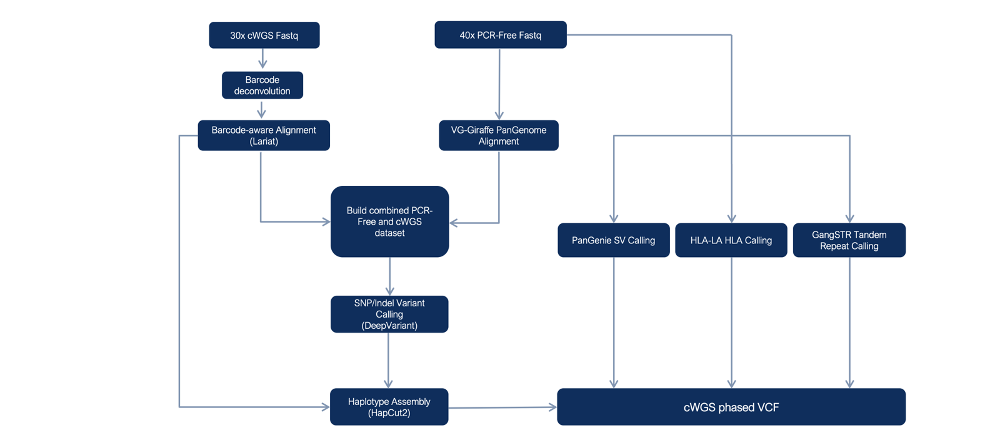

# Complete WGS (cWGS)  
This is a pipeline that enables the mapping, variant calling, and phasing of input fastq files from a PCR free (PF) and a Complete Genomics' DNBSEQ Complete WGS (cWGS) (a DNA cobarcoding technology, previous name stLFR) library of the same sample. Running this pipeline results in a highly accurate and complete phased VCF. We recommend at least 40X depth for the PCR free library and 30X depth for the cWGS library. Below is a flow chart which summarizes the pipeline processes. *Note, SV detection with Pangenie is a beta version of the pipeline.*

> **⚠️ This version supports SE600 data only.**
> It is built and validated for single-end 600 bp cWGS (stLFR2) and PCR-free SE600 libraries, and **accepts pre-aligned BAM input only** (`--frombam true`).
> Paired-end cWGS/stLFR data (PE100/PE150, Lariat) is **not supported or validated** in this version; for PE data use the `dev` branch or an earlier release.
> The vg-based FASTQ path (barcode splitting + vg giraffe) and the haplotype de novo module (`--run_haplodenovo`) are not fully tested yet.



A more detailed flow chart.  

```mermaid
flowchart TD

    subgraph INPUT["Input"]
        samplesheet([samplesheet.csv]) --> toCsv[toCsv]
        toCsv --> parse_sample[parse_sample]
        parse_sample --> fq[(fq)]
    end

    subgraph QC_PF["QC — PF Reads"]
        qc_pf[qc_pf] --> readLenPf[readLenPf]
        qc_pf --> fqcheckPf[fqcheckPf]
        fqcheckPf --> fqdistPf[fqdistPf]
        qc_pf --> fqstats_pf[fqstats_pf]
    end

    subgraph QC_STLFR["QC — stLFR Reads"]
        qc_stlfr_stats[qc_stlfr_stats] --> readLen[readLen]
        qc_stlfr_stats --> basecount[basecount]
        qc_stlfr_stats --> fqstats_stlfr[fqstats_stlfr]
    end

    subgraph ALIGN_PF["Alignment — PF"]
        bwaPf[bwaPf] --> markdupPf[markdupPf]
        markdupPf --> sampleBamPf[sampleBamPf]
    end

    subgraph STATS_PF["Stats — PF BAM"]
        sampleBamPf_s[sampleBamPf] --> coveragePf[coveragePf]
        sampleBamPf_s --> coverageMeanPf[coverageMeanPf]
        sampleBamPf_s --> samtoolsFlagstatPf[samtoolsFlagstatPf]
        sampleBamPf_s --> samtoolsStatsPf[samtoolsStatsPf]
        sampleBamPf_s --> samtoolsDepthPf[samtoolsDepthPf]
        sampleBamPf_s --> insertsizePf[insertsizePf]
        samtoolsFlagstatPf --> alignCatPf[alignCatPf]
        samtoolsStatsPf --> alignCatPf
        samtoolsDepthPf --> alignCatPf
        insertsizePf --> alignCatPf
    end

    subgraph ALIGN_STLFR["Alignment — stLFR / Lariat"]
        barcode_split[barcode_split] --> splitfq[splitfq]
        splitfq --> lariatBC[lariatBC]
        lariatBC --> mergeFq[mergeFq]
        mergeFq --> lariat[lariat]
        lariat --> sortbam[sortbam]
        sortbam --> markdupStlfrLariat[markdupStlfrLariat]
        markdupStlfrLariat --> sampleBamStlfrLariat[sampleBamStlfrLariat]
    end

    subgraph ALIGN_SE600["Alignment — SE600 / vg giraffe"]
        barcode_split_se600[barcode_split_se600] --> kff_se600[kff]
        kff_se600 --> vg_se600[vg giraffe]
        vg_se600 --> addBxSe600[addBxSe600]
        addBxSe600 --> markdup_se600[markdup]
    end

    subgraph STATS_STLFR["Stats — stLFR BAM"]
        sampleBamStlfrLariat_s[sampleBamStlfrLariat] --> samtools_flagstat[samtools_flagstat]
        sampleBamStlfrLariat_s --> samtools_stats[samtools_stats]
        sampleBamStlfrLariat_s --> insertsize[insertsize]
        sampleBamStlfrLariat_s --> samtools_depth[samtools_depth]
        sampleBamStlfrLariat_s --> stLFRQC[stLFRQC]
        samtools_flagstat --> align_cat[align_cat]
        samtools_stats --> align_cat
        samtools_depth --> align_cat
        insertsize --> align_cat
    end

    subgraph PHASE["Phasing"]
        intersectLariat[intersectLariat] --> mergeBamLariat[mergeBamLariat]
        mergeBamLariat --> deepvariantv16[deepvariantv16]
        mergeBamLariat --> coverage[coverage]
        mergeBamLariat --> coverageMean[coverageMean]
        coverage --> coverageAvg[coverageAvg]
        coverageMean --> coverageAvg
        deepvariantv16 --> vcfevalLariatDv[vcfevalLariatDv]
        deepvariantv16 --> varStatsLariatDv[varStatsLariatDv]
        deepvariantv16 --> splitVcfLariatDv[splitVcfLariatDv]
        sampleBamStlfrLariat_p[sampleBamStlfrLariat] --> splitBam4phasing[splitBam4phasing]
        splitBam4phasing --> phaseLariatDv[phaseLariatDv]
        splitVcfLariatDv --> phaseLariatDv
        phaseLariatDv --> phaseCatLariatDv[phaseCatLariatDv]
        phaseCatLariatDv --> hapKaryotype[hapKaryotype]
        phaseCatLariatDv --> hapcutstat[hapcutstat]
        phaseCatLariatDv --> phaseall[phaseall]
        phaseCatLariatDv --> ideogram[ideogram]
        phaseCatLariatDv --> cumuplot[cumuplot]
    end

    subgraph HAPLODENOVO["Per-haplotype De Novo Assembly (optional)"]
        haplotag[whatshap haplotag] --> propagateBxHp[propagateBxHp]
        propagateBxHp --> makeWindows[makeWindows]
        makeWindows --> denovoBatch[denovoBatch ×N]
        denovoBatch --> catContigs[catContigs]
    end

    subgraph SV_STR_HLA["SV / STR / immune-gene typing — hg38/GRCh38 only"]
        pangenie[pangenie] --> pangenie_var_plot[pangenie_var_plot]
        pangenie --> pangenie_plot[pangenie_plot]
        gangstr[gangstr]
        specimmune[specimmune]
    end

    subgraph ANNOT["Annotation — hg38/GRCh38 only"]
        vep_frombam[vep_frombam] --> vep_data[vep_data]
    end

    subgraph REPORT["Report"]
        reportLariatDv[reportLariatDv] --> report([report])
        report --> html([html])
    end

    %% Cross-subgraph edges
    fq --> qc_pf
    fq --> qc_stlfr_stats
    fq --> barcode_split
    fq --> barcode_split_se600
    qc_pf --> bwaPf

    sampleBamPf --> sampleBamPf_s
    sampleBamPf --> intersectLariat
    sampleBamPf --> mergeBamLariat

    sampleBamStlfrLariat --> sampleBamStlfrLariat_s
    sampleBamStlfrLariat --> sampleBamStlfrLariat_p
    sampleBamStlfrLariat --> intersectLariat
    sampleBamStlfrLariat --> mergeBamLariat

    %% haplodenovo
    mergeBamLariat --> haplotag
    phaseCatLariatDv --> haplotag

    %% SV/STR/HLA inputs
    fq --> pangenie
    mergeBamLariat --> gangstr
    pfbam[PF mapq-filtered BAM] --> specimmune
    phaseCatLariatDv --> pangenie_plot

    %% Annotation input
    phaseCatLariatDv --> vep_frombam

    alignCatPf --> reportLariatDv
    align_cat --> reportLariatDv
    vcfevalLariatDv --> reportLariatDv
    varStatsLariatDv --> reportLariatDv
    coverageAvg --> reportLariatDv
    phaseCatLariatDv --> reportLariatDv
    stLFRQC --> reportLariatDv

    vep_data --> html
    pangenie_var_plot --> html
    pangenie_plot --> html
    specimmune --> html

    %% Styling
    classDef input    fill:#dae8fc,stroke:#6c8ebf
    classDef qc       fill:#d5e8d4,stroke:#82b366
    classDef align    fill:#fff2cc,stroke:#d6b656
    classDef vc       fill:#f8cecc,stroke:#b85450
    classDef phase    fill:#e1d5e7,stroke:#9673a6
    classDef stats    fill:#f0f0f0,stroke:#666666
    classDef report   fill:#ffe6cc,stroke:#d79b00
    classDef sv       fill:#fce4d6,stroke:#c0504d
    classDef annot    fill:#e2efda,stroke:#70ad47
    classDef denovo   fill:#fdf2f8,stroke:#a64d79

    class samplesheet,fq,parse_sample,toCsv input
    class qc_pf,readLenPf,fqcheckPf,fqdistPf,fqstats_pf,qc_stlfr_stats,readLen,basecount,fqstats_stlfr qc
    class bwaPf,markdupPf,sampleBamPf,barcode_split,splitfq,lariatBC,mergeFq,lariat,sortbam,markdupStlfrLariat,sampleBamStlfrLariat,barcode_split_se600,kff_se600,vg_se600,addBxSe600,markdup_se600 align
    class deepvariantv16,vcfevalLariatDv,varStatsLariatDv vc
    class splitVcfLariatDv,splitBam4phasing,phaseLariatDv,phaseCatLariatDv,hapKaryotype,hapcutstat,phaseall,intersectLariat,mergeBamLariat,ideogram,cumuplot phase
    class coveragePf,coverageMeanPf,samtoolsFlagstatPf,samtoolsStatsPf,samtoolsDepthPf,insertsizePf,alignCatPf,samtools_flagstat,samtools_stats,insertsize,samtools_depth,stLFRQC,align_cat,coverage,coverageMean,coverageAvg stats
    class reportLariatDv,report,html report
    class pangenie,pangenie_plot,pangenie_var_plot,gangstr,specimmune sv
    class vep_frombam,vep_data annot
    class haplotag,propagateBxHp,makeWindows,denovoBatch,catContigs denovo

```


# Requirements  
**Hardware requirements**  
Multiple core computer (default >=48 CPU)  
Minimum 72 GB RAM  
Exact storage may vary depending on sample count and coverage; expect ~1 TB per sample.  

**Software requirements**  
Linux CentOS >=7  
Nextflow >= 25.04.6  
You may need root access to install Singularity (Singularity is a more secure container platform as it does not require root access on execution, while Docker does.)      

# Installation   
1. Install the host runtime (Nextflow and Java) and the optional SpecImmune
   Conda environment. The install prefix must be visible to every execution node:
```bash
./scripts/install-cwgs-host-tools.sh /shared/apps/cwgs-host-tools
export NXF_HOME=/shared/apps/cwgs-host-tools/nxf-home
export PATH=/shared/apps/cwgs-host-tools/runtime/bin:$PATH
```
This pins Nextflow `25.04.6` and SpecImmune `v0.0.3`. The installer uses the
exact `environment.yml` shipped by that SpecImmune tag and does not install the
SpecImmune database.

2. On a Linux server, install singularity >= 3.8.1 with root on every node.
   
3. Download the singularity images (internet connection required):
```bash
cat <<EOF > CWGS.def
Bootstrap: docker
From: stlfr/cwgs:1.0.6
%post
    cp /90-environment.sh /.singularity.d/env/
EOF

singularity build --fakeroot CWGS.sif CWGS.def
```
**Users without root permission may build the .sif file locally then upload to the server.**  
If singularity doesn't support `--fakeroot`, use sudo:
```bash
sudo singularity build CWGS.sif CWGS.def
singularity exec -B`pwd -P` --pwd `pwd -P` CWGS.sif cp -rL /usr/local/bin/CWGS /usr/local/bin/runit /usr/local/app/CWGS/PARAMS.txt .
```

4. Download the database (internet connection required):
```bash
./CWGS -createdb
```
This downloads ~32 GB and builds indices locally (~30 GB additional). Use [db_tree.txt](docs/db_tree.txt) to validate completion.

   **Additional files for this release.** Add the following to the `CWGS_db` created above (`DB=/path/to/CWGS_db`). Run from the repository root:

   a. Small files shipped in [db/](db/):
```bash
mkdir -p ${DB}/barcode ${DB}/hg38/panGenome
cp db/barcode/barcode.list db/barcode/tenx.whitelist                ${DB}/barcode/
cp db/GRCh38_CMRG_benchmark_gene_coordinates.bed                    ${DB}/hg38/
cp db/GRCh38_PAR.bed                                                ${DB}/hg38/panGenome/
cp db/GCA_000001405.15_GRCh38_no_alt_analysis_set_corrected.fasta.nonN.region ${DB}/hg38/panGenome/
```
   `GRCh38_PAR.bed` is used by DeepVariant for male samples (chrX/chrY haploid calling). It is read from the same directory as the pangenome `.gbz`, or set `--dv_par_regions_bed`.

   b. Public files to download:

| File | Source | Put in |
|------|--------|--------|
| `hprc-v1.1-mc-grch38.gbz` (3.3 GB) | [HPRC](https://s3-us-west-2.amazonaws.com/human-pangenomics/pangenomes/freeze/freeze1/minigraph-cactus/hprc-v1.1-mc-grch38/hprc-v1.1-mc-grch38.gbz) | `${DB}/hg38/panGenome/` |
| `GCA_000001405.15_GRCh38_no_alt_analysis_set_corrected.fasta` (+ `.fai`, `.dict`, bwa index) | built from NCBI GCA_000001405.15 with `python scripts/cwgs_supp.py --module corrected_fasta --db_path ${DB}` (needs `_RAWDATA_/GCA_000001405.15_GRCh38_no_alt_analysis_set.fna.gz`) | `${DB}/hg38/panGenome/` |
| SpecImmune HLA database | build from [SpecImmune](https://github.com/deepomicslab/SpecImmune) (tag `v0.0.3`) following its instructions | `${DB}/SpecImmune/db` (or pass `--specimmune_db`) |
| PanGenie index (`HPRC_index_chr*`, `cactus_filtered_ids_biallelic.vcf.gz`) | build with [PanGenie](https://github.com/eblerjana/pangenie) | `${DB}/pangenie/` (only for the beta SV module) |
| DeepVariant SE600 model `checkpoint-177536-0.98710-1` | `gsutil -m cp "gs://brain-genomics-public/experimental/exp276475129/wu_1/best/*" <dir>/` | any path; pass `--dv_customized_model <dir>` |

   After copying, compare with [db_tree.txt](docs/db_tree.txt).

5. Pull SIF containers for the Nextflow module pipeline:
```bash
for name in pangenie vg denovo; do
    apptainer pull oras://docker.io/stlfr/complete_wgs:${name}
done
```
Remove the `complete_wgs_` prefix from .sif filenames and place them in `${sif_dir}`.

# Samplesheet format

> **Only SE600 data is supported in this version, as BAM input.** The PE150 columns and examples below are kept for reference and are not validated in this release.

The samplesheet is a **CSV file** with a unified format for all run modes (from FASTQ or from BAM). Leave columns empty if not applicable.

```
sample,stlfr1,stlfr2,pcrfree1,pcrfree2,stlfrbam,pfbam
```

| Column | Description |
|--------|-------------|
| `sample` | Sample ID (used in output file names) |
| `stlfr1` | cWGS/stLFR **PE150** R1 FASTQ (gzipped) |
| `stlfr2` | cWGS/stLFR **PE150** R2 FASTQ (gzipped) |
| `stlfr21` | cWGS/stLFR **SE600** FASTQ (gzipped, single-end) |
| `pcrfree1` | PCR-free **PE** R1 FASTQ (gzipped) |
| `pcrfree2` | PCR-free **PE** R2 FASTQ (gzipped) |
| `pcrfree21` | PCR-free **SE600** FASTQ (gzipped, single-end); do not combine with `pcrfree1/2` in one row |
| `stlfrbam` | Pre-aligned cWGS BAM (for `--frombam` mode) |
| `pfbam` | Pre-aligned PCR-free BAM (for `--frombam` mode) |

**Library types:**

| Library | Chemistry | Columns | Aligner |
|---------|-----------|---------|---------|
| stLFR PE150 | Paired-end 150 bp | `stlfr1` + `stlfr2` | Lariat |
| SE600 (stLFR2) | Single-end 600 bp | `stlfr21` only | vg giraffe |
| PCR-free SE600 | Single-end 600 bp | `pcrfree21` only | vg giraffe |

**Start from FASTQ — PE150** *(not supported in this version)*:
```csv
sample,stlfr1,stlfr2,pcrfree1,pcrfree2,stlfrbam,pfbam
demo1,/path/cWGS_01_1.fq.gz,/path/cWGS_01_2.fq.gz,/path/PF_01_1.fq.gz,/path/PF_01_2.fq.gz,,
demo2,/path/cWGS_02_1.fq.gz,/path/cWGS_02_2.fq.gz,/path/PF_02_1.fq.gz,/path/PF_02_2.fq.gz,,
```

**Start from FASTQ — SE600** (single-end; use `stlfr21` and/or `pcrfree21`):
```csv
sample,stlfr21,pcrfree21,stlfrbam,pfbam
demo1,/path/stLFR_SE600.fq.gz,/path/PCRfree_SE600.fq.gz,,
```

PCR-free SE600 bypasses the paired-end SOAPnuke QC and FASTQ downsampling steps; run it with `--pfAligner vg` (the default).

### Immune-gene typing for SE600

For hg38/GRCh38, `specimmune` exports HLA-relevant primary reads from the PF (PCR-free)
MAPQ-filtered BAM (`*.pf.mapqlt<pfmapq>.bam`, not the merged BAM) as a
single-end FASTQ and types `HLA`. Only the MHC region (`--specimmune_region`,
default `chr6:28000000-34000000`), chr6 MHC alt contigs (`--specimmune_alt_regex`)
and unmapped reads are extracted; feeding whole-genome reads made SpecImmune run
for more than a day and crash in its visualization step. Set
`--specimmune_use_extract true` to use SpecImmune's own `ExtractReads.sh -g HLA`
instead; this needs an hg38 BAM with alt contigs, which the vg PF BAM does not have. Run
`scripts/install-cwgs-host-tools.sh` once, build the SpecImmune HLA database
outside the Nextflow work directory, and provide all three external paths:

```bash
nextflow run modules/main.nf -profile singularity \
  --input samplesheet.csv --outdir ./output \
  --specimmune_env /shared/apps/cwgs-host-tools/specimmune-env \
  --specimmune_home /shared/apps/cwgs-host-tools/SpecImmune \
  --specimmune_db /path/to/specimmune-hla-db
```

The configured `--specimmune_read_type pacbio` is the SE600 compatibility
setting and should be benchmarked against known samples before production use.
The HLA result directory is copied into `report/<sample>/specimmune_out/` and
shown in the final HTML report. If SpecImmune fails, or exits 0 without writing an
HLA result file, a `FAILED` file with the reason is written in
`specimmune_out/HLA/` and the pipeline continues. KIR, CYP, and IG/TR remain disabled until their
databases are built.

GangSTR requires a paired-end insert-size distribution and is disabled by
default for SE600 (`--skip_gangstr true`). It does not contribute to the final
HTML report. Use `--skip_gangstr false` only for a compatible paired-end BAM.

### DeepVariant settings

DeepVariant runs only on the merged BAM, as pangenome-aware DeepVariant v1.10
(`run_pangenome_aware_deepvariant`) with the HPRC v1.1 graph. The pangenome
defaults to `${DB}/${ref}/panGenome/` and follows the `-db` override.
```
--dv_container PATH           DeepVariant .sif container (v1.10 with the chrX/chrY flags)
--dv_pangenome PATH           .gbz pangenome graph [unset: taken from ${DB}]
--dv_customized_model PATH    SE600 fine-tuned checkpoint; a checkpoint directory is
                              resolved to its TF checkpoint prefix from the *.index file.
                              Set "" to use the stock WGS model.
--dv_gbz_shm_size_gb INT      Shared memory for the GBZ [50]
```
The DeepVariant `.sif` is not published on Docker Hub (`stlfr/complete_wgs`); convert
the Google image yourself and point `--dv_container` to it. The SE600 checkpoint is not
distributed with the repository.

Build the DeepVariant `.sif` (no root needed):
```bash
# with internet access: pull and convert directly
singularity build deepvariant-1.10.0-xyflags.sif \
    docker://google/deepvariant:pangenome_aware_deepvariant-1.10.0-xyflags

# server without internet: on a machine with Docker, pull and export
docker pull google/deepvariant:pangenome_aware_deepvariant-1.10.0-xyflags
docker save google/deepvariant:pangenome_aware_deepvariant-1.10.0-xyflags -o deepvariant-1.10.0-xyflags.tar
# copy the .tar to the server, then (note the three slashes):
singularity build deepvariant-1.10.0-xyflags.sif \
    docker-archive:///absolute/path/to/deepvariant-1.10.0-xyflags.tar
# or, if the Docker daemon is on the same machine:
singularity build deepvariant-1.10.0-xyflags.sif \
    docker-daemon://google/deepvariant:pangenome_aware_deepvariant-1.10.0-xyflags
```
Then run with `--dv_container /path/to/deepvariant-1.10.0-xyflags.sif`.

### DeepVariant sex setting

Use `--dv_sex_mode male` or `--dv_sex_mode female` when the sample sex is
known. For an unknown sample, use `auto` (the default), which classifies sex
from mean chrY depth. A shell launcher can make this explicit while preserving
automatic detection when `sex` is unset:

```bash
sex="${sex:-auto}"  # male, female, or auto
nextflow run modules/main.nf ... --dv_sex_mode "$sex"
```

**Start from BAM** (`--frombam true`). FASTQ columns (`pcrfree1`/`pcrfree2`, or `pcrfree21` for PF SE600) are used for PanGenie SV genotyping if provided:
```csv
sample,stlfr1,stlfr2,pcrfree1,pcrfree2,stlfrbam,pfbam
demo1,,,/path/PF_01_1.fq.gz,/path/PF_01_2.fq.gz,/path/cWGS_01.bam,/path/PF_01.bam
```

Paths may be absolute or relative. Empty fields are skipped automatically.

# Run the pipeline

**Note: single-dash parameters (`-opt`) must come before double-dash parameters (`--opt`)**

## Entry points

```bash
# From FASTQ
nextflow run modules/main.nf -entry CWGS \
    --input samplesheet.csv --outdir ./output --ref hg38 --var_tool dv

# From BAM
nextflow run modules/main.nf -entry CWGS_frombam \
    --input samplesheet.csv --outdir ./output --ref hg38 --var_tool dv --frombam true
```

For SE600 VG BAM input, provide both `stlfrbam` and `pfbam` and leave
`fromMergedBam` at its default `false`. The workflow merges the two BAMs before
DeepVariant; it does not call variants on either input BAM separately.

## Key parameters

### CPU / Memory
```
--cpu2 INT    CPUs for QC, markdup, merge bam, bam stats [24]
--cpu3 INT    CPUs for alignment and variant calling [48]
```

### FASTQ downsampling
```
--sampleFq BOOL          Downsample input FASTQ [false]
--stLFR_fq_cov INT       Target cWGS coverage for FASTQ downsampling [40]
--PF_fq_cov INT          Target PF coverage for FASTQ downsampling [50]
```

### Alignment
```
--align_tool STRING    cWGS alignment tool [lariat]
                         bwa | lariat | bwa,lariat
--pfAligner STRING     PF alignment tool [vg]
                         bwa | vg
--pfmapq INT           Minimum MAPQ filter for PF BAM [3]
```

### Variant calling
```
--var_tool STRING      Variant caller [dv]
                         gatk | dv | gatk,dv
--gatk_version STRING  GATK version [v4]  (v3 | v4)
--run_bqsr BOOL        Run BQSR [true]
--run_vqsr BOOL        Run VQSR [true]
```

### Duplicate marking
```
--markdup STRING    Mark-duplicates tool [picard]
                      picard | biobambam2 | gatk4 | sambamba
```

### BAM downsampling
```
--sampleBam BOOL          Downsample BAMs [true]
--stLFR_sampling_cov INT  Target cWGS BAM coverage [30]
--PF_sampling_cov INT     Target PF BAM coverage [40]
```

### BAM merging
```
--PF_lt_stLFR_depth INT   Depth threshold for stLFR/PF intersection [10]
--just_combine BOOL       Simply merge stLFR + PF BAMs without intersection [false]
```

### Per-haplotype de novo assembly *(optional)*
Assembles each haplotype independently in overlapping 60 kb windows using whatshap + megahit. Requires the `denovo.sif` container.
```
--run_haplodenovo BOOL      Enable per-haplotype de novo assembly [false]
--denovo_window_size INT    Window size in bp [60000]
--denovo_window_step INT    Step size in bp [30000]
--denovo_chunk_lines INT    Windows per Nextflow task [200]
--denovo_min_reads INT      Minimum reads per window to attempt assembly [50]
--denovo_max_reads INT      Maximum reads per window (subsampled if exceeded) [20000]
--denovo_min_contig INT     Minimum contig length to retain [500]
```
Output: `{outdir}/{sample}/haplodenovo/{sample}.hp1.contigs.fa.gz` and `.hp2.contigs.fa.gz`

### Special modes
```
--stLFR_only BOOL     Run cWGS alignment only, skip PF and merging [false]   (alignment only: no variant calling)
--PF_only BOOL        Run PF alignment only [false]                          (alignment only: no variant calling)
--frombam BOOL        Start from pre-aligned BAM files [false]
--keepFiles BOOL      Keep intermediate files to enable -resume [false]
--demo BOOL           Skip optional analyses (gangstr, SpecImmune) [false]
```

### Sample type (truth-based steps)
```
--sample_type STR     hg001 | hg002 | random [random]
                      hg001/hg002: run vcfeval and phasing-accuracy stats against the GIAB truth set in ${DB}/hg38
                      random:      any other sample; vcfeval and phasing-accuracy stats are skipped
```

## Logs and re-computing CMRG

After a `CWGS run`, the `.command.{sh,out,err,log}` and `.exitcode` of every task are copied
from the Nextflow work directory (using the `workdir` column of `trace.txt`) to
`<output>/logs/<process>/<tag>/`, so failures can be inspected after `work/` is cleaned.

To fill the CMRG report fields of an already finished run without re-aligning or re-calling:
```bash
bash scripts/cmrg_from_results.sh <outdir> <sample> [align_tool=lariat] [var_tool=dv]
```
Needs bedtools and python3 with pandas and intervaltree. The result is written to
`<outdir>/<sample>/cmrg_manual/<sample>.cmrg.report`.

## Cluster execution

| Mode | Command |
|------|---------|
| SGE | `CWGS sample.csv --queue all.q --project none > run.log 2>&1 &` |
| Local | `CWGS sample.csv -exec local > run.log 2>&1 &` |

Additional parameters can be set in [modules/nextflow.config](modules/nextflow.config) (MEM, CPU, DeepVariant model, etc.).

# Output

All output in `--outdir/<sample_name>/`.

```
align/
  <sample>.stlfr.lariat.biobambam2.bam      # cWGS aligned BAM
  <sample>.pf.vg.biobambam2.bam             # PF aligned BAM
  <sample>.lariat.merge.bam                 # merged BAM (stLFR + PF)
  <sample>.lariat.dv.vcf.gz                 # DeepVariant VCF

phase/
  <sample>.lariat.dv.phased.vcf.gz          # phased VCF
  <sample>.lariat.dv.hapblock               # HapCUT2 haplotype blocks
  <sample>.lariat.dv.phase.report           # phasing statistics

haplodenovo/                                 # only with --run_haplodenovo
  <sample>.haplotag.bam
  <sample>.hp1.contigs.fa.gz
  <sample>.hp2.contigs.fa.gz
  <sample>.hp1.contigs.stats.txt
  <sample>.hp2.contigs.stats.txt

report/
  report.csv                                 # summary metrics; fields of failed/missing steps show FAIL
  <sample>/specimmune_out/                   # HLA typing (hg38 only)
  chromosome.png                             # ideogram
  cumulative_coverage_plot.png
  <sample>.vep.vcf_summary.html             # VEP annotation summary
```

**Typical runtime** (1 sample, 30× cWGS + 40× PF, 60 CPU):  
~45 hr  
(Multiple samples run in parallel; total ≤ N × per-sample time)

# Reference   
1. [Lariat](https://github.com/10XGenomics/lariat) — Linked-Read Alignment Tool  
2. [Deepvariant](https://github.com/google/deepvariant) — Deep learning-based variant caller  
3. [Hapcut2](https://github.com/vibansal/HapCUT2) — Haplotype assembly  
4. [SOAPnuke](https://github.com/BGI-flexlab/SOAPnuke) — Quality control  
5. [cWGS/stLFR](https://www.ncbi.nlm.nih.gov/pmc/articles/PMC6499310/) — DNA cobarcoding technique  
6. [vg giraffe](https://github.com/vgteam/vg) — Pangenome graph aligner  
7. [PanGenie](https://github.com/eblerjana/pangenie) — Pangenome-based SV genotyping  
8. [whatshap](https://github.com/whatshap/whatshap) — Read-based phasing  
9. [MEGAHIT](https://github.com/voutcn/megahit) — Ultra-fast de novo assembler
